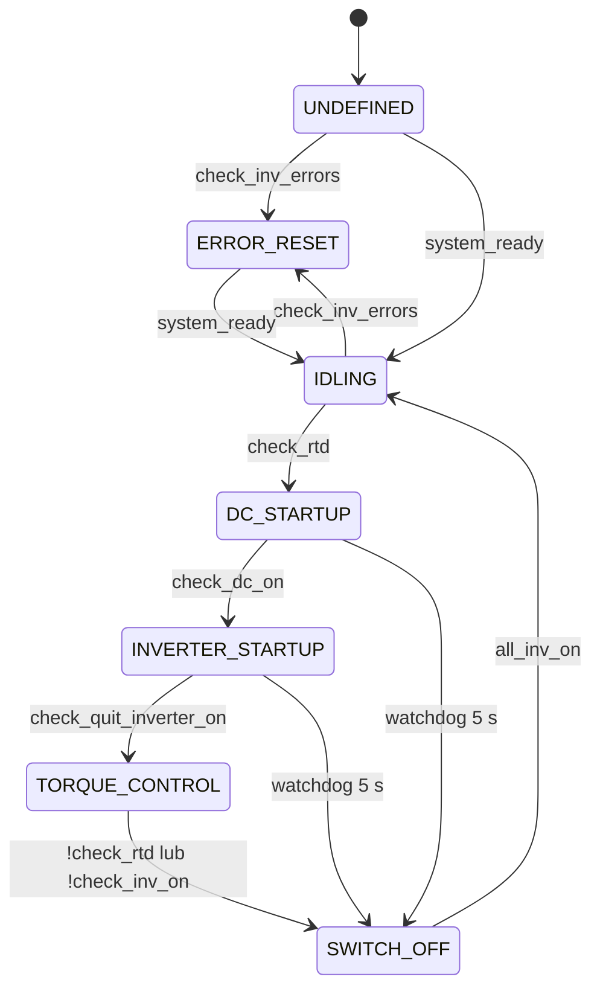

# AmkNode - sterowanie falownikami AMK

`amk_node` steruje czterema falownikami AMK (FL, FR, RL, RR) za pomocą maszyny stanów. Maszyna stanów opiera się na diagramie włączania i wyłączania z dokumentacji AMK:

> **AMK, PDK_205481_KW26-S5-FSE-4Q, wersja 2020/44, rozdz. 9.5 „On and off diagram 'Free CAN message configuration'", str. 91/114**

Węzeł czyta statusy falowników (`AMK_xxx`) i wysyła do nich bity sterujące oraz zadany moment przez CAN, za pośrednictwem innych węzłów ROS.

---

## 1. Interfejs ROS

### Publikowane topici

| Temat | Typ | Opis |
|---|---|---|
| `amk/front/left/setpoints` | `AmkSetpoints` | Sterowanie falownikiem FL |
| `amk/front/right/setpoints` | `AmkSetpoints` | Sterowanie falownikiem FR |
| `amk/rear/left/setpoints` | `AmkSetpoints` | Sterowanie falownikiem RL |
| `amk/rear/right/setpoints` | `AmkSetpoints` | Sterowanie falownikiem RR |
| `state_machine` | `StateMachine` | Stan wystawiany na zewnątrz: `0` w `IDLING`, `1` w `SWITCH_OFF` (patrz pkt 6) |

### Subskrybowane topici

| Temat | Typ | Opis |
|---|---|---|
| `amk/{front,rear}/{left,right}/actual_values1` | `AmkActualValues1` | Statusy falowników (`system_ready`, `quit_dc_on`, `quit_inverter_on`, `dc_on`, `inverter_on`, `error`, `actual_velocity`) |
| `rtd` | `Rtd` | Ready-to-drive. `state == true` pozwala rozpocząć start falowników |
| `setpoints` | `Setpoints` | Zadane momenty (`front_left`, `front_right`, `rear_left`, `rear_right`) |

### Timery

| Timer | Okres | Funkcja |
|---|---|---|
| `amk_setpoints_timer` | 2 ms | Publikuje setpointy do wszystkich 4 falowników, niezależnie od stanu |
| `amk_state_machine_timer` | 5 ms | `update_motor_states()`, transitions, `on_update()` |
| `setpoints_watchdog` | 500 ms | Brak `setpoints` przez 500 ms: wszystkie momenty = 0 (jednorazowo) |
| `amk_state_machine_watchdog` | 5000 ms | Start (DC/INVERTER) trwa dłużej niż 5 s: wymuszone `SWITCH_OFF` |

Oba watchdogi są po starcie anulowane. `setpoints_watchdog` uzbraja się przy pierwszej wiadomości `setpoints`, a `amk_state_machine_watchdog` przy wejściu w `DC_STARTUP`.

---

## 2. Maszyna stanów



Transitions są sprawdzane w kolejności dodania, a pierwszy spełniony wygrywa (`break`). Zaraz po transition wywoływane jest `on_update()` nowego stanu.

### Opis stanów

| Stan | `on_update` | Warunek wyjścia |
|---|---|---|
| `UNDEFINED` | Stan początkowy, brak akcji | `system_ready` (wszystkie falowniki) lub błąd falownika |
| `IDLING` | Publikuje `state_machine.state = 0` | `rtd == true` lub błąd falownika |
| `DC_STARTUP` | `dc_on = true`, limity momentu = 0, moment = 0. Czeka na `quit_dc_on` | `quit_dc_on` na wszystkich |
| `INVERTER_STARTUP` | `inverter_on = true`, `enable = true`. Czeka na `quit_inverter_on` | `quit_inverter_on` na wszystkich |
| `TORQUE_CONTROL` | Limity ±2000, przekazywanie momentu z `setpoints`, obsługa błędów silników (pkt 4) | `rtd == false` lub utrata statusów `inverter_on`/`dc_on` |
| `SWITCH_OFF` | `inverter_on`, `enable`, `dc_on` = false, limity i moment = 0. Publikuje `state_machine.state = 1` | Wszystkie bity `quit_*`, `inverter_on`, `dc_on` = 0 i `rtd == false` |
| `ERROR_RESET` | Ustawia `error_reset = true` (czyszczone przy wyjściu) | `system_ready` |

### Funkcje warunków

| Funkcja | Zwraca `true`, gdy… |
|---|---|
| `check_rtd()` | `rtd.state == true` |
| `system_ready()` | Każdy falownik ma `system_ready` (lub jest odcięty) |
| `check_dc_on()` | Każdy falownik ma `quit_dc_on` (lub jest odcięty) |
| `check_quit_inverter_on()` | Każdy falownik ma `quit_inverter_on` (lub jest odcięty) |
| `check_inv_on()` | Każdy falownik ma `quit_inverter_on && quit_dc_on && inverter_on && dc_on`. Odcięte i resetujące się są ignorowane |
| `check_inv_errors()` | Którykolwiek nieodcięty falownik ma `error` |
| `all_inv_on()` | Zwraca `true`, gdy wszystkie bity są wyłączone i `rtd == false`, czyli falowniki są wyłączone |

---

## 3. Obsługa błędów pojedynczego silnika

`update_motor_states()` jest wywoływane na początku **każdego** cyklu maszyny stanów (5 ms), przed sprawdzaniem transitions. Dla każdego falownika (struktura `MotorState`: `fl_state`, `fr_state`, `rl_state`, `rr_state`):

1. `amk_status.error == true`: `is_resetting = true`, zapamiętanie czasu startu.
2. Błąd trwa dłużej niż **5 s**: `is_cut_off = true`. Silnik jest trwale wyłączony z logiki.
3. Błąd zniknął: `is_resetting = false`.

Skutki:

- **Odcięty silnik** (`is_cut_off`): w `TORQUE_CONTROL` wszystkie bity i moment = 0. Funkcje warunków traktują go jako „OK", więc pojazd może jechać na pozostałych silnikach.
- **Silnik w resecie** (`is_resetting`): `error_reset = true`, bity `inverter_on`, `enable`, `dc_on` podtrzymane, moment = 0. `check_inv_on()` go ignoruje, dzięki czemu chwilowy błąd nie wyrzuca całego układu do `SWITCH_OFF`.
- **Brak błędu**: `error_reset = false`, moment z `setpoints`, bity sterujące podtrzymane (powrót po błędzie).

---

## 4. Zabezpieczenia

- **Overspeed:** jeśli którykolwiek falownik ma `actual_velocity > 20000`, momenty wszystkich czterech silników = 0.
- **Setpoints watchdog (500 ms):** brak wiadomości `setpoints` zeruje momenty (jednorazowo, następna wiadomość uzbraja watchdog ponownie).
- **State machine watchdog (5 s):** `DC_STARTUP` lub `INVERTER_STARTUP` trwa zbyt długo: `state = SWITCH_OFF` i publikacja `state_machine.state = 1`.
- **Utrata RTD** lub statusów falowników w `TORQUE_CONTROL`: przejście do `SWITCH_OFF`.

---

## 5. Uruchomienie


```bash
ros2 run putm_vcl amk_node
```

Wymagane są węzły dostarczające `rtd`, `setpoints` i `amk/*/actual_values1` oraz węzły CAN odbierające `amk/*/setpoints`.